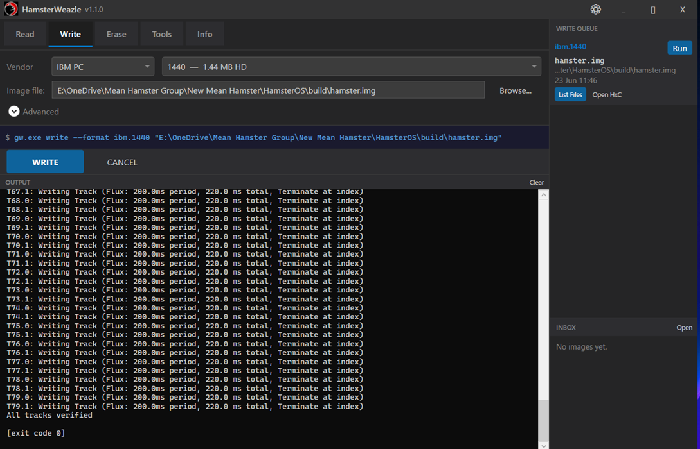

# HamsterWeazle

**Development version:** v1.5.10 · **Published Windows download:** v1.5.9

Windows v1.5.9 adds an optional track map (off by default), automatic capture reports, rescue reads that preserve original images, and DOS image tools in a separate window. The Mac source includes these improvements; published Mac downloads remain v1.5.5 until native packages are ready.

Version 1.5.10 uses the **Workbench** interface: an operation rail, a fixed-size retro drive display, and a tabbed image library. Settings opens as a workspace beneath Tools in the rail and saves changes automatically. Advanced settings, Activity & command, and the optional track map stay out of the way until needed. Light and Dark appearances are available alongside the Amiga theme. **Buy Me a Coffee** is directly visible in the header.

**HamsterWeazle** is a clean, modern GUI for [GreaseWeazle](https://github.com/keirf/greaseweazle), built to make reading, writing, and managing floppy disk images easier — on Windows and macOS.

GreaseWeazle is powerful, but working with floppy disks can involve multiple tools, command-line steps, firmware utilities, and separate disk-image viewers. HamsterWeazle brings the common workflow together in one easy-to-use place.

Built by **John Swiderski** / [Mean Hamster Software](https://meanhamster.com)

---

## Installation

### Windows

1. Download `HamsterWeazle-Windows.exe` from the [HamsterWeazle product page](https://meanhamster.com/products/hamsterweazle)
2. Run it

### macOS

1. Download `HamsterWeazle-Mac-AppleSilicon.zip` (M1/M2/M3/M4) or `HamsterWeazle-Mac-Intel.zip` from the [HamsterWeazle product page](https://meanhamster.com/products/hamsterweazle)
2. Unzip and drag **HamsterWeazle.app** to your Applications folder
3. **First launch only:** right-click → Open → Open (macOS security prompt for apps outside the App Store)

That is all. On first launch, HamsterWeazle automatically downloads and installs the GreaseWeazle host tools and HxCFloppyEmulator. HamsterWeazle app updates are delivered from meanhamster.com.

See [USAGE.md](USAGE.md) for a step-by-step guide.

See [ROADMAP.md](ROADMAP.md) for planned reliability, Mac 800K, and drive-profile improvements.

---

## What you need

**Windows**
- Windows 10/11 x64
- [.NET 10 Desktop Runtime](https://dotnet.microsoft.com/download/dotnet/10.0) (free, one-time install)
- A [GreaseWeazle](https://github.com/keirf/greaseweazle) USB adapter and a floppy drive

**macOS**
- macOS 12 or later (Intel or Apple Silicon)
- A [GreaseWeazle](https://github.com/keirf/greaseweazle) USB adapter and a floppy drive
- GreaseWeazle host tools installed via: `pipx install greaseweazle`

---

## What it does

GreaseWeazle reads and writes floppy disks at the raw magnetic flux level, supporting dozens of vintage computer formats. HamsterWeazle puts a clean interface on top so you can get straight to imaging disks.

- **Read** a physical floppy to an image file
- **Auto Read** an unknown disk — probes common formats, picks the best match automatically
- **Write** an image file back to a floppy
- **Erase** disks
- **Browse and extract** DOS FAT12 files directly; use HxCFloppyEmulator for other supported filesystems
- **Rescue** missing sectors by combining another read with a previous capture, keeping both originals
- **Review** automatic capture reports, or enable the optional track map when needed
- **Create and edit** DOS data images in a separate Disk Image Tools window, saving a new copy
- **Update** GreaseWeazle device firmware and run drive cleaning tools
- **Repeat** previous write jobs from the Write Queue with one click
- **Archive** read images automatically in the Inbox folder
- **Select** PC cable A:/B: or Shugart DS0-DS3 drives without leaving the Advanced panel
- **Save** tested read/write settings as named presets for quick reuse

---

## Features

### Auto Read

Click **Auto Read** and HamsterWeazle probes common formats, scores decoded sectors, and starts the full read with the best match. Empty, failed and mismatched-header probes cannot win. A strong match requires complete decoding of both probed cylinders and every expected side.

### Optional track map and capture reports

The **Track map** checkbox beside the main action shows a compact row for each side, with track status and details on hover. It defaults **off**, consumes no space when hidden, and remembers your choice. Reports are saved regardless of whether the map is visible.

Each read, write and erase records the command, result, full output and available image hash in a readable text report and a JSON sidecar. Cancelled reads retain their partial results. Use the Inbox/Write Queue context menu to view a report, or **Tools > Analyze Saved Log** to inspect earlier output without connecting hardware. A written track and a verified track are distinct statuses.

### Rescue Read

Use **Read > Advanced > Rescue Read**, or the Inbox context menu, to recover a previously captured disk. A matching report identifies which sectors were decoded successfully. Another complete pass is saved separately, and only previously missing or unknown sectors are filled in a new combined image. Valid older data, including zero-filled sectors, is preserved; disagreements are counted and both captures remain available.

Rescue supports full-sized flat IBM PC, Amiga, Atari ST and MSX sector images with matching geometry. Flux, DMK and variable-layout captures remain separate originals.

### Disk Image Tools

**Tools > Disk Image Tools** opens a separate window for DOS FAT12 browsing and extraction. Create a blank 360 KB, 720 KB, 1.2 MB, 1.44 MB or 2.88 MB data image, add host files using DOS 8.3 names, and **Save copy**. Edits stay in memory until saved and cannot overwrite the original image. HxC remains available for other filesystems.

### Format auto-detection when writing

| Extension / Size | Format detected |
|---|---|
| `.adf` | Amiga AmigaDOS 880 KB or HD |
| `.d64` / `.d71` / `.d81` | Commodore 1541 / 1571 / 1581 |
| `.st` / `.msa` | Atari ST 360/720/1440 KB |
| `.dmk` | Tandy / TRS-80 DMK (Windows, optional gw2dmk tools) |
| `.scp` / `.hfe` / `.kf` | Raw flux (no --format flag needed) |
| `.img` by size | IBM PC 160 KB through 2.88 MB |
| 901,120 bytes | Amiga AmigaDOS DD |

For DOS images, valid boot-sector geometry takes precedence over file size and the detected basis appears beneath the path. Standard flat-image writes reject conflicting image sizes or DOS geometry before starting the hardware tool.

### Write Queue and Inbox

The **Write Queue** remembers every previous write job, including vendor, format, image path, drive selection, and write options. Choose **Repeat write** from a job's actions menu to restore and repeat it. The **Inbox** archives every disk you read, organised automatically with rename and delete.

### Tandy / TRS-80 DMK (Windows v1.5.6)

Read and write `.dmk` images with the optional [gw2dmk/dmk2gw tools](https://github.com/qbarnes/gw2dmk), installed from **Settings > Software Updates > gw2dmk (optional)**. Select **Tandy / TRS-80 > dmk** for reads, or open a `.dmk` file for writes. Queued DMK writes use the same tools, and diagnostic logs are retained after errors.

The current DMK read profile captures one side, intended for the Model II workflow. DMK writes are reported as **not verified** because dmk2gw does not perform read-back verification. See [USAGE.md](USAGE.md#tandy--trs-80-dmk-windows) for setup and limits.

### Drive selection

The **Advanced** panel keeps drive selection compact: use **Auto** for normal setups, **PC cable A:/B:** for standard dual-drive cables, or **Shugart DS0-DS3** for multi-drive Shugart configurations.

Windows v1.5.7 uses explicit `--drive=B`-style arguments in previews and execution. Drive cleaning also respects the selected drive and COM port; device-info commands omit the unsupported drive flag.

### Presets

Save known-good Advanced settings as named presets, then apply them before a read or write. Presets store vendor, format, drive selection, cylinder range, retries, revolutions, and verify settings without tying them to a specific image file.

### COM port / device selection

HamsterWeazle auto-detects the GreaseWeazle device. A dropdown under **Device** lets you override it if needed.

### Automatic setup and updates

HamsterWeazle manages GreaseWeazle host tools, HxCFloppyEmulator, and its own updates automatically.

Windows v1.5.8 adds **Check for Updates** to the main window. Check on demand and see whether an update is available, your installed version is current, or the update service could not be reached.

### Themes

Light, Dark and Amiga Workbench themes. Use the appearance button for Light/Dark, or **Settings > Appearance** for all three.

---

## Supported formats

Amiga, IBM PC (all densities), Apple II, Atari 8-bit, Atari ST, Commodore, Macintosh, MSX, ZX Spectrum, Sega, Acorn, DEC, and many more.

---

## Third-party software

- [GreaseWeazle host tools](https://github.com/keirf/greaseweazle) by Keir Fraser (The Unlicense)
- [HxCFloppyEmulator](https://github.com/jfdelnero/HxCFloppyEmulator) by Jean-Francois Del Nero (GPL v3)
- [gw2dmk / dmk2gw](https://github.com/qbarnes/gw2dmk), based on Tim Mann's cw2dmk utilities (GPL v2; optional Windows download)

---

## License

Copyright (c) 2026 Mean Hamster Software - John Swiderski. All rights reserved.

HamsterWeazle is free to download and use for personal and non-commercial purposes. Modification and redistribution are not permitted without written permission from the copyright holder.

---

## Disclaimer

HamsterWeazle interfaces indirectly with floppy disk hardware via GreaseWeazle at the raw magnetic flux level. While every effort has been made to make it safe and reliable, the authors accept no responsibility for data loss, damaged media, hardware faults, or any other issues that may arise from its use.

Always keep backup copies of disk images you care about. Floppy disks are fragile, and decades-old media may be unreliable regardless of the software used. This software is provided as-is, without warranty of any kind.
